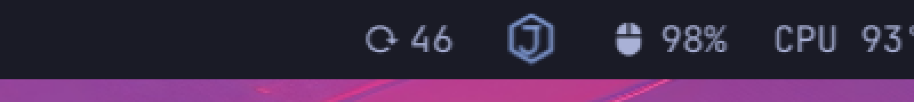
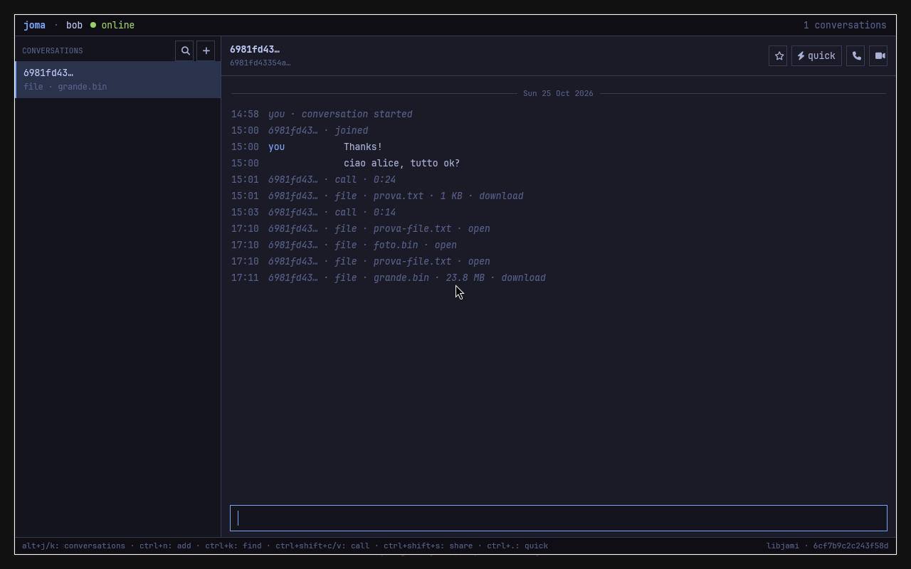

# How to read

Same as before: tick `- [ ] A:` to agree, or write what you want instead.

# What was done

- **Q3, Joma stays in the background.** Closing the window now hides it (Hyprland has
  no minimize; the window goes to the hidden workspace `special:joma`). Joma keeps
  receiving messages and calls, the bar widget keeps working, and the launcher, `joma`,
  `joma open` or an incoming call bring the window back. To really quit: Ctrl+Q in the
  window, or `joma quit`. When Joma is not running, the bar widget stays, dimmed;
  clicking it offers "Open Joma".
- **Q3, the bar icon** is now the Joma hexagon with the J, drawn as neon tubes in the
  Omarchy theme's accent colour (blue with your current theme), so it follows theme
  changes. The unread count appears next to it.
- **Q5, receiving files.** Files up to 20 MB (the Jami app's default) download by
  themselves into `~/Downloads/joma/`, with a desktop notification; same names get
  ` (2)`. Larger ones show their size in the chat: click to download. A received file
  shows "open": click to open it. It also knows the files the Jami app downloaded.
  Verified between the two test profiles, with the receiver's window closed: three
  files arrived intact, the 24 MB one waited for a click.
- **Q6, the VA-API tier** stays, opt-in only and never on the screen's GPU (D-10 in
  `DECISIONS.md`). It costs nothing when unused and is the only hardware path for older
  AMD cards; if it never gets used we can drop it later.
- **Installed on zoma:** the new `~/.local/bin/joma` and the bar icon. The Joma you have
  open since 17:03 is the previous version: quit it (Ctrl+Q) and start it again to get
  the new behaviour.





# Questions

**Q1. The `joma quick` window.** Sorry, I was unclear. Besides the bar panel there is a
second, older way to send a quick message: `joma quick` (or Ctrl+. inside Joma) opens a
small separate Joma window, "Joma Quick", with your contacts on the left and the nine
quick messages on the right; you pick a contact with j/k and send with 1 to 9. The bar
panel now does all of this and more. I propose to remove that window and keep
`joma quick --json` (the bar uses it) and the quick messages inside Joma's main window
(Alt+1..9). OK?

- [x] A: ok

**Q2. zavito** (from this afternoon, still open). On zavito: `sudo pacman -S jami-daemon`,
then from here `! ~/Projects/joma-messenger/scripts/install.sh --no-build zavito`. Then a
call between your account here and one on zavito, with a desktop share each way.

- [ ] A:

**Q3. GitHub.** You chose private. The permission system does not let me create it, so
please run:

```
! cd ~/Projects/joma-messenger && gh repo create dzanaga/joma-messenger --private --source . --remote origin --push
```

- [x] A: done

# Not tested yet

- Clicking a large file to download it (the click handler; the automatic download is
  verified).
- Hiding and showing the window on your desktop (verified in the test Hyprland).
